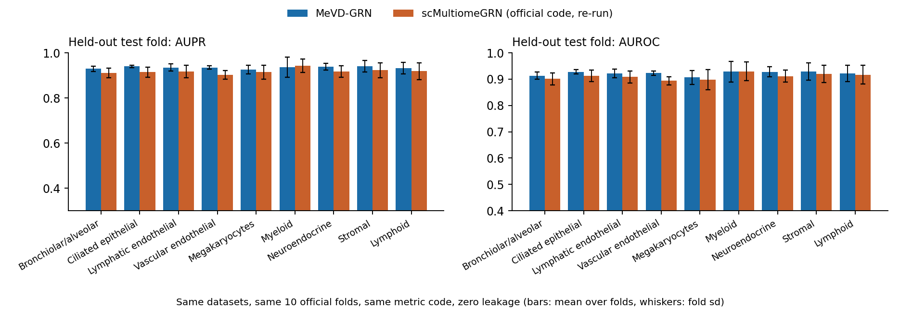
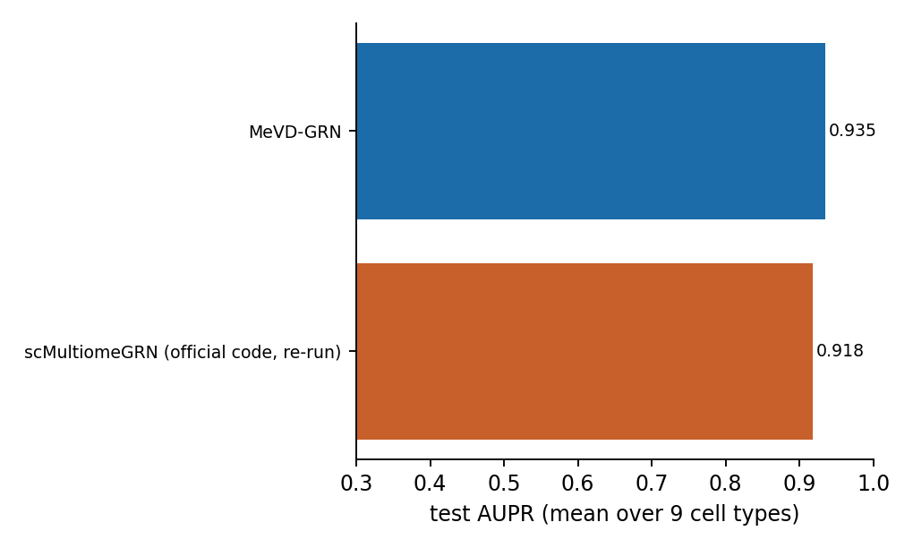
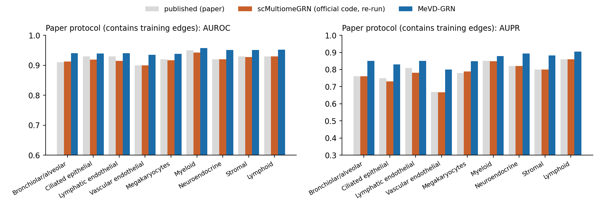

# MeVD-GRN vs scMultiomeGRN: an apples-to-apples comparison

Advisor meeting, 17 Oct 2026, 11:00. One slide per section; slides are separated by `---`.
Branch `scmgrn-tftf`. Every model result here is **zero-leakage**: the held-out fold is never seen in training.

> **DRAFT.** Slides marked `[PENDING]` are filled from the finished runs (`results/lung/summary.md`).

---

## 1. Summary

1. **What we did this week:** rebuilt the scMultiomeGRN benchmark and ran both models on it, with the same data,
   the same 10 official folds, the same metric code, and the same task (undirected TF-TF link prediction).
2. **What we changed in our model:** it now predicts *undirected TF-TF links* like scMultiomeGRN (before, it predicted
   directed TF-to-gene edges), and it can read scMultiomeGRN's own inputs. The score of a pair no longer depends on the
   order of the two TFs.
3. **[PENDING] Result.**
4. **Honest limits:** the answer key of this benchmark is built from the same ATAC data the models read
   (a motif scan), so it measures how well a model recovers a motif-and-promoter rule, not experimentally confirmed regulation.

---

## 2. What scMultiomeGRN does (Xu et al., NAR 2025)

- **Task:** predict links between *pairs of TFs* (an undirected graph of TF-TF regulation), separately for each cell type.
- **Answer key:** not ChIP-seq. A TF-TF link exists if a motif hit of one TF falls in the promoter (TSS ± 2 kb) of the other,
  in peaks open in more than 10% of that cell type's cells.
- **Inputs per TF:** accessibility score of its gene (MAESTRO), and its GRNBoost2 links to all genes; per TF pair, a 16 × 16
  joint histogram of the two TFs' expression.
- **Model:** a graph neural network (GCN encoder with attention over RNA and ATAC), trained on a known part of the graph
  to rebuild the rest.
- **Data:** human fetal lung (9 cell types), plus adult hematopoiesis (HSC, CMP, GMP). Paper averages on lung:
  AUROC 0.924, AUPR 0.790.

---

## 3. What "apples to apples" means here

| | scMultiomeGRN | MeVD-GRN (this work) |
|---|---|---|
| Data | Domcke fetal lung, 9 cell types | the same files |
| Answer key | motif-in-promoter graph | the same graph, regenerated with their method |
| Splits | 10 folds, seed 666 | the same fold files (checked byte-for-byte against their code) |
| Task | undirected TF-TF links | undirected TF-TF links |
| Scoring code | their `metric_fn` | the same function |
| Inputs | MAESTRO, GRNBoost2, histograms, training graph | the same four inputs (plus our own features) |
| Runs | their code, re-run: 6 seeds × 10 folds | 5 seeds × 10 folds |

**Headline score = the held-out test fold** (positives plus an equal number of random non-links). The paper's own numbers are on
the *full* matrix, which includes the links the model was trained on, so we show those separately and label them.

---

## 4. What we changed in our model

- **Before:** score(TF → gene) with different roles for the two ends; on this benchmark we averaged the two directions.
- **Now:** one embedding per TF, and a score that is **the same whichever TF comes first** (unit-tested).
  Both RNA and ATAC channels are still read by their own graph networks and fused afterwards.
- **Inputs matched:** scMultiomeGRN's accessibility and GRNBoost2 features (compressed to 64 numbers each),
  the pair histogram, and the training graph. None of them uses a held-out link.
- **Old directed model kept** as ablation A3, to show what the change buys.

| Variant | What it is |
|---|---|
| **H** (headline) | undirected, all four inputs |
| A1 | without the scMultiomeGRN-specific input features |
| A2 | without the training graph (only label-free graphs) |
| A3 | the old directed model, scores averaged |

---

## 5. How we kept it fair

- The held-out fold's positives and negatives never enter training (asserted in code on every fold).
- Training negatives come only from the fold's training negatives.
- The input graphs are built without labels.
- The motif relation is switched off: the answer key *is* a motif scan.
- The best epoch is chosen on the validation split only.
- The official scMultiomeGRN code is re-run unmodified on our regenerated data, so any gap to the published numbers is visible.
- Every result file records its leak status; the compile step refuses to run if any run is not zero-leak.

---

## 6. [PENDING] Did we rebuild the benchmark correctly?

*Checks before any comparison:*
1. Number of TF-TF links we regenerate per cell type vs the paper's Table S1.
2. Official code, re-run on our data: its full-matrix AUROC / AUPR vs the paper's.
3. Our fold files identical to what the official split code writes.

---

## 7. [PENDING] Headline: held-out test fold

---

## 8. [PENDING] Where the gain (or loss) comes from

---

## 9. [PENDING] In the paper's own protocol

*This protocol scores links the model was trained on. We show it only to compare with the published numbers.*

---

## 10. Honest caveats

- The answer key is generated from the same ATAC data the models read, so a model that learns the motif-promoter rule
  scores well without learning biology. This holds for scMultiomeGRN and for us.
- In the lung data the "RNA" modality is gene-body accessibility, not RNA (per GEO), so both modalities are really ATAC.
- Only a subset of cell types may be finished: see the table for which.
- Hematopoiesis: inputs are built for scRNA; the scATAC counting needs the single-cell BAMs and has not been run.
- CMP scRNA is our reading of three labels (cmp0, cmp1, cmp2); the paper does not say which it used.

---

## 11. Next steps

- Finish the remaining lung cell types and hematopoiesis.
- Decide, with you, whether this benchmark is worth more time given its circular answer key, or whether to return to BEAR-GRN
  (which uses experimental ground truth) with the undirected idea.
