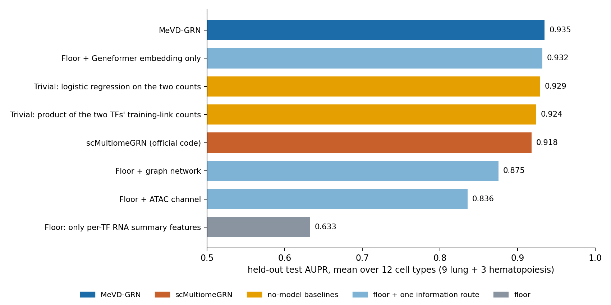
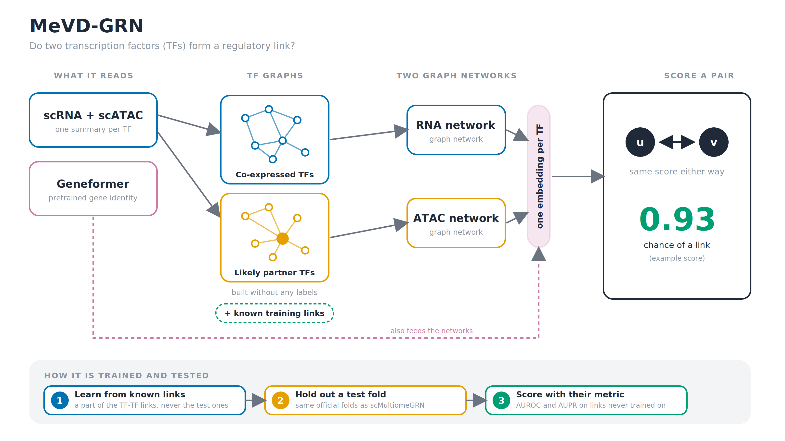
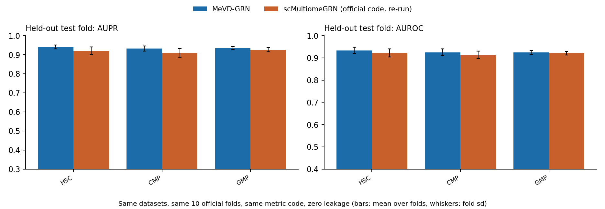
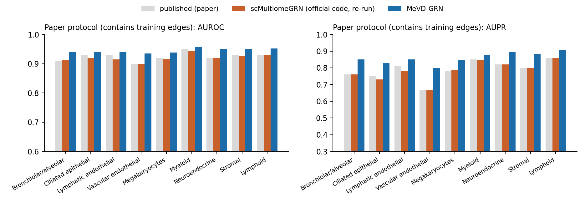

# MeVD-GRN against scMultiomeGRN, on scMultiomeGRN's own benchmark

Advisor meeting, Saturday 17 October 2026, 11:00. Work from 11 to 17 October.

In the result tables, **bold** marks the best score in a row and *italics* the second best, for AUROC and AUPR separately.

## 1. The question and the short answer

- MeVD-GRN was built to predict which transcription factor (TF) regulates which gene. scMultiomeGRN, published in Nucleic Acids Research, tackles a related task: it predicts which pairs of TFs are linked in a given cell type.
- This week we asked a simple question. If both models are trained and tested on scMultiomeGRN's own datasets, splits and scoring code, which one does better?
- To make that a fair contest we rebuilt the benchmark from raw data, checked that the authors' own code reproduces their published numbers on our rebuild, and changed MeVD-GRN so that it solves the same task.
- On the held-out test links MeVD-GRN comes out ahead, but only by a little. Its average AUPR over the nine lung cell types is 0.935, against 0.918 for scMultiomeGRN.
- MeVD-GRN wins on eight of the nine lung cell types and on all three blood cell types. The difference is statistically significant on six of the nine lung cell types, and Myeloid is the only one where scMultiomeGRN is slightly better.
- Three later findings change how this result should be read, and we think they matter more than the headline number.
- First, when we strip MeVD-GRN down to its simplest form its score drops to 0.63, but adding back only the pretrained Geneformer gene embedding brings it to 0.932. That embedding carries no information about the cells, only about which TFs are involved.
- Second, a rule with no model at all, which just counts how many known links each TF already has, reaches 0.929. That beats scMultiomeGRN and covers about two thirds of MeVD-GRN's lead.
- Third, the benchmark's answer key is computed from the same ATAC data the models read. Put together, this suggests the benchmark mostly rewards knowing which TFs tend to have many links, and that MeVD-GRN's real edge beyond that is about 0.006 AUPR.

## 2. The task both models solve

- scMultiomeGRN looks at one cell type at a time and builds a graph whose nodes are TFs. The job is to predict which pairs of TFs are connected.
- The links have no direction. A link between TF A and TF B does not say which one regulates the other.
- The answer key does not come from experiments. Following an earlier method, DeepTFni, A and B are linked when a binding motif of A (HOCOMOCO v11, FIMO p at most 1e-6) sits inside the promoter of B, within 2 kb of its start site, in DNA that is open in more than 10% of the cells.
- We rebuilt this answer key with the same tools and the same thresholds. In practice, the task is to recover a motif-in-promoter rule among TFs from single-cell data.

## 3. The datasets

- The main dataset is human fetal lung (Domcke et al., Science 2020; GEO GSM4508936), with 72,662 cells across nine cell types.
- One detail matters here. According to its GEO description, the "RNA" part of this object is gene-body accessibility rather than RNA expression, so both modalities really come from ATAC.
- The last two columns compare the size of our rebuilt graphs with the paper's own Table S1. They agree to within 5% on every cell type.

| Cell type | Cells | TFs (nodes) | Links (undirected) | Directed entries, ours / paper | Link density |
|---|---|---|---|---|---|
| Myeloid | 1,288 | 46 | 266 | 532 / 542 | 0.26 |
| Lymphoid | 1,860 | 41 | 301 | 602 / 613 | 0.37 |
| Megakaryocytes | 568 | 64 | 459 | 918 / 930 | 0.23 |
| Neuroendocrine | 544 | 69 | 674 | 1,348 / 1,361 | 0.29 |
| Lymphatic endothelial | 662 | 94 | 936 | 1,872 / 1,889 | 0.21 |
| Stromal | 43,289 | 94 | 1,044 | 2,088 / 2,104 | 0.24 |
| Bronchiolar and alveolar epithelial | 18,988 | 115 | 1,346 | 2,692 / 2,712 | 0.21 |
| Ciliated epithelial | 1,111 | 228 | 4,254 | 8,508 / 8,503 | 0.16 |
| Vascular endothelial | 4,352 | 271 | 5,026 | 10,052 / 9,609 | 0.14 |

- The second dataset is human adult hematopoiesis (Buenrostro et al., Cell 2018), with three blood cell types.
- Here the ATAC and RNA data come from separate experiments, exactly as in the scMultiomeGRN paper. We took the ATAC counts from GEO (GSE96769) and the RNA from the paper's supplementary data.
- For CMP we merged three RNA labels (cmp0, cmp1 and cmp2), because the paper does not say which ones it used.

| Cell type | scATAC cells | scRNA cells | TFs (nodes) | Links (undirected) |
|---|---|---|---|---|
| HSC | 347 | 2,268 | 150 | 1,519 |
| CMP | 502 | 4,454 | 171 | 2,016 |
| GMP | 402 | 1,096 | 157 | 1,556 |

## 4. How scMultiomeGRN works

- Each TF is a node. For every TF the model computes an accessibility score from the ATAC data and an importance profile over all genes from the RNA data.
- For every pair of TFs it also computes a small histogram of how their expression varies together.
- Two graph neural networks, one for each kind of data, pass information between neighbouring TFs using attention. A cross-modal attention layer then merges the two views into one representation per TF.
- A pair is scored by the inner product of the two TF representations, and the model learns to rebuild the known links.
- The paper's final network is a majority vote over ten runs. We ran the authors' code exactly as they released it.

## 5. How MeVD-GRN works (the version used this week)

- MeVD-GRN starts by summarising each TF in a handful of numbers taken from the RNA and ATAC data.
- It adds a pretrained gene embedding from Geneformer. This gives every gene a fixed vector that is the same in every cell type.
- It then builds two graphs between TFs without looking at any labels. One connects TFs that are co-expressed, and the other connects each TF to the partners it is most likely to relate to, judged from accessibility and expression together.
- During training it also passes messages over the fold's known training links. The test links are never part of this graph.
- Two graph networks run over these graphs, one for the RNA view and one for the ATAC view, and their outputs are merged into a single embedding per TF.
- A pair scorer turns the embeddings of two TFs into the chance that they are linked. The scorer gives the same answer for (u, v) as for (v, u), which is what an undirected task needs.
- The model has 4.88 million parameters and trains in a few seconds per fold.

## 6. What we changed in MeVD-GRN for a fair comparison

- The original MeVD-GRN predicts a directed edge from a TF to a gene, and its scorer treats the two ends differently. That is the wrong shape for an undirected answer key.
- We replaced it with a scorer that is symmetric by design. It combines the two TF embeddings only through terms that ignore order, and a unit test checks that both orders give identical scores.
- We also merged the RNA and ATAC graph networks into one embedding per TF. Before, the two views were kept apart until the very last step.
- We switched off MeVD-GRN's own motif relation. The answer key is itself a motif scan, so using it would be circular.
- Training uses the same budget as scMultiomeGRN, with at most 2,000 epochs and a stop after 100 epochs without improvement. The epoch we keep is picked on a validation split, never on the test links.
- The rest of the model is our standard configuration, which was fixed before any result came in: hidden size 384, two graph layers and the Geneformer embedding.

## 7. How the comparison was set up

- Both methods get the same data, the same splits and the same scoring code.
- The splits are scMultiomeGRN's own: ten folds made with its random seed, 666. Our fold files are byte-for-byte identical to the ones the authors' split code writes.
- In each fold, a tenth of the known links plus the same number of random non-links is held out for testing. Another 18% of the links is kept aside for validation.
- Scores come from the authors' own metric function. AUROC is the chance that a true link is ranked above a non-link, and AUPR is the area under the precision-recall curve.
- Our headline numbers are on the held-out test links only. The paper scores the full matrix of TF pairs, which includes the training links, so we report that separately on slide 14 to compare with the published figures.
- We ran the official code with six seeds on the first five lung cell types and two seeds on the rest. MeVD-GRN ran with five seeds everywhere.

## 8. How we kept test data out of training

- The test links and non-links never appear in the training data, and a check in the code enforces this on every fold.
- Negative training examples are drawn only from each fold's training negatives.
- The graphs MeVD-GRN reads are built without any labels.
- Every MeVD-GRN result file records that it ran in this zero-leak mode, and the script that compiles the results refuses any file that did not.
- No setting was tuned on test results. The configuration was fixed before the first result came in.

## 9. Did we rebuild the benchmark correctly?

- The authors do not release their processed data, so the comparison only means something if our rebuild matches theirs. We checked this three ways.
- Our link counts are within 5% of the paper's Table S1 on all nine lung cell types (slide 3). The largest gap is Vascular endothelial, at 4.6% above.
- Our fold files are identical to the official split code's output, in all 30 files for each of the twelve cell types.
- Most convincingly, the official scMultiomeGRN code run unchanged on our data gives back the paper's own scores on the paper's own metric.

| Cell type | Paper, AUROC / AUPR | Our re-run of the official code |
|---|---|---|
| Myeloid | 0.95 / 0.85 | 0.943 / 0.849 |
| Lymphoid | 0.93 / 0.86 | 0.929 / 0.861 |
| Megakaryocytes | 0.92 / 0.78 | 0.917 / 0.788 |
| Neuroendocrine | 0.92 / 0.82 | 0.920 / 0.820 |
| Lymphatic endothelial | 0.93 / 0.81 | 0.915 / 0.781 |
| Bronchiolar and alveolar | 0.91 / 0.76 | 0.913 / 0.760 |
| Ciliated epithelial | 0.93 / 0.75 | 0.918 / 0.730 |
| Vascular endothelial | 0.90 / 0.67 | 0.899 / 0.668 |
| Stromal | 0.93 / 0.80 | 0.927 / 0.800 |
| HSC (hematopoiesis) | 0.92 / 0.67 | 0.927 / 0.696 |
| CMP (hematopoiesis) | 0.92 / 0.66 | 0.927 / 0.692 |
| GMP (hematopoiesis) | 0.93 / 0.71 | 0.928 / 0.681 |

- Averaged over the nine lung cell types, the re-run scores 0.920 / 0.784, against 0.924 / 0.790 in the paper. We are comparing against a faithful copy of the published method, not a weakened one.

## 10. Main result: lung, held-out test links

- The table shows AUROC / AUPR on the held-out links, averaged over the ten folds and then over the seeds.

| Cell type | MeVD-GRN | scMultiomeGRN (official code) |
|---|---|---|
| Bronchiolar and alveolar | **0.913** / **0.929** | *0.901* / *0.911* |
| Ciliated epithelial | **0.928** / **0.940** | *0.912* / *0.915* |
| Vascular endothelial | **0.923** / **0.935** | *0.894* / *0.902* |
| Stromal | **0.929** / **0.941** | *0.920* / *0.923* |
| Lymphatic endothelial | **0.921** / **0.935** | *0.908* / *0.917* |
| Megakaryocytes | **0.907** / **0.925** | *0.898* / *0.915* |
| Myeloid | *0.928* / *0.936* | **0.930** / **0.943** |
| Neuroendocrine | **0.928** / **0.939** | *0.912* / *0.917* |
| Lymphoid | **0.922** / **0.932** | *0.917* / *0.918* |
| Average of the nine | **0.922** / **0.935** | *0.910* / *0.918* |

- To check whether these gaps are real, we compared the two methods fold by fold, since both used the same folds, with a Wilcoxon signed-rank test.

| Cell type | AUPR difference | p | AUROC difference | p |
|---|---|---|---|---|
| Vascular endothelial | +0.033 | 0.002 | +0.030 | 0.002 |
| Ciliated epithelial | +0.025 | 0.002 | +0.016 | 0.004 |
| Neuroendocrine | +0.022 | 0.002 | +0.016 | 0.002 |
| Bronchiolar and alveolar | +0.019 | 0.002 | +0.012 | 0.020 |
| Lymphatic endothelial | +0.018 | 0.002 | +0.013 | 0.010 |
| Stromal | +0.018 | 0.004 | +0.009 | 0.010 |
| Lymphoid | +0.014 | 0.105 | +0.005 | 0.557 |
| Megakaryocytes | +0.010 | 0.105 | +0.009 | 0.232 |
| Myeloid | -0.007 | 0.770 | -0.002 | 0.715 |
| Pooled over all 90 fold pairs | +0.017 | 2e-11 | +0.012 | 1e-9 |

- MeVD-GRN is ahead on AUPR in 88% of the 90 cell-type and fold pairs, and on AUROC in 79%.
- The gains are small, mostly one to three points of AUPR, while scores move by two to five points from one fold to the next.
- With only ten folds per cell type, 0.002 is the smallest p-value this test can produce.
- The pooled p-value treats the folds of one cell type as independent, even though they share a graph, so it is too optimistic.
- The fair summary is that MeVD-GRN is consistently a little better, not dramatically better.

## 11. Main result: hematopoiesis

- The blood data show the same pattern on a second, independent dataset.

| Cell type | MeVD-GRN | scMultiomeGRN (official code) |
|---|---|---|
| HSC | **0.934** / **0.941** | *0.922* / *0.921* |
| CMP | **0.925** / **0.932** | *0.914* / *0.909* |
| GMP | **0.925** / **0.935** | *0.921* / *0.926* |
| Average of the three | **0.928** / **0.936** | *0.919* / *0.919* |

- Fold by fold against the official code, MeVD-GRN gains 0.021 AUPR on HSC (p = 0.002), 0.023 on CMP (p = 0.002) and 0.009 on GMP (p = 0.027).
- Pooled over the 30 fold pairs, the gain is 0.017 AUPR (p = 4e-8) and 0.009 AUROC (p = 8e-8), and MeVD-GRN is ahead in 93% of the pairs.
- Keep in mind that the RNA and ATAC data were measured in different cells here, and that the CMP RNA merges three labels.

## 12. Where does MeVD-GRN's score come from?

- To find out what the model actually relies on, we built a floor model. It keeps only the per-TF summary features, the pair scorer and a smaller network, with no Geneformer embedding, no ATAC channel, no graph network and no known links.
- We then added back exactly one of those parts at a time and ran every version on all twelve cell types with five seeds.
- The table gives the average held-out score over the twelve cell types and the difference from MeVD-GRN.

| Version | AUPR | Difference from MeVD-GRN | AUROC | Difference from MeVD-GRN |
|---|---|---|---|---|
| MeVD-GRN | **0.935** | – | **0.924** | – |
| Floor model: only the per-TF summary features (no Geneformer, no ATAC channel, no graph network, no known links) | 0.633 | -0.302 | 0.635 | -0.289 |
| Floor model plus the ATAC channel | 0.836 | -0.099 | 0.823 | -0.100 |
| Floor model plus the graph network over label-free graphs | 0.875 | -0.060 | 0.862 | -0.062 |
| Floor model plus the Geneformer embedding | *0.932* | -0.003 | *0.921* | -0.003 |
| scMultiomeGRN, official code (for reference) | 0.918 | -0.017 | 0.912 | -0.011 |

- The floor model collapses to 0.633 AUPR, about 0.30 below MeVD-GRN. The summary features alone are not enough.
- Adding the ATAC channel brings it to 0.836, and adding the graph network brings it to 0.875. Both help, but neither gets close to the full model.
- Adding only the Geneformer embedding brings it to 0.932, which is 0.003 below MeVD-GRN and 0.014 above scMultiomeGRN.
- The Geneformer embedding is a fixed vector per gene and is the same in every cell type. It knows nothing about the cell data, only which TFs are in the pair.
- So a model that only knows which two TFs it is looking at does almost as well as the full model. This points to the identity of the TFs, rather than anything specific to the cell type, as the main source of signal. The next slide tests that directly.

## 13. A no-model baseline: counting known links

- The official folds split links, not TFs, so every TF shows up in the training links.
- A TF with many known links in training is likely to have many among the test links too. A method can exploit this hub effect without learning anything about regulation.
- To measure how much this explains, we built a baseline with no model, no features and no cell data.
- For a test pair of TFs, the baseline counts how many training links each of the two TFs has. It then scores the pair by the product of the two counts, or with a logistic regression on them.
- It only uses each fold's training links, and it is scored with the same code as every other method.

| Method (held-out test links, 12 cell types) | AUPR | AUROC |
|---|---|---|
| scMultiomeGRN, official code | 0.918 | 0.912 |
| No-model baseline: product of the two TFs' training-link counts | 0.924 | 0.912 |
| No-model baseline: logistic regression on the two counts | *0.929* | *0.917* |
| MeVD-GRN | **0.935** | **0.924** |

- The counting baseline beats scMultiomeGRN on AUPR and matches or beats it on AUROC. On this split, scMultiomeGRN does no better than a rule that counts known links.
- Of the 0.017 AUPR that MeVD-GRN gains over scMultiomeGRN, about 0.011 can be had from counting alone.
- What MeVD-GRN adds beyond the hub effect is about 0.006 AUPR and 0.007 AUROC. That is small but real: a fold-paired test over 120 pairs gives p = 6e-9 for AUPR and 1e-8 for AUROC.
- This matches what we saw with BEAR-GRN, where simple in-degree rankers matched or beat published methods and reviewers expected splits that hold out whole TFs.
- A stricter version of this benchmark would hold out all the links of some TFs, which removes the counting shortcut. We have not run it yet, and it is the obvious next experiment.

## 14. The paper's own evaluation (for reference only)

- The paper scores the full matrix of all TF pairs, including the links each model was trained on. We show it only so the numbers can be compared with the published ones, and we draw no conclusions from it.
- The last column holds the published figures for scMultiomeGRN and is not ranked.

| Cell type | MeVD-GRN | scMultiomeGRN (official code) | Paper (published, not ranked) |
|---|---|---|---|
| Bronchiolar and alveolar | **0.940** / **0.850** | *0.913* / *0.760* | 0.91 / 0.76 |
| Ciliated epithelial | **0.939** / **0.829** | *0.918* / *0.730* | 0.93 / 0.75 |
| Vascular endothelial | **0.935** / **0.801** | *0.899* / *0.668* | 0.90 / 0.67 |
| Stromal | **0.951** / **0.883** | *0.927* / *0.800* | 0.93 / 0.80 |
| Lymphatic endothelial | **0.940** / **0.850** | *0.915* / *0.781* | 0.93 / 0.81 |
| Megakaryocytes | **0.938** / **0.849** | *0.917* / *0.788* | 0.92 / 0.78 |
| Myeloid | **0.957** / **0.879** | *0.943* / *0.849* | 0.95 / 0.85 |
| Neuroendocrine | **0.951** / **0.894** | *0.920* / *0.820* | 0.92 / 0.82 |
| Lymphoid | **0.951** / **0.905** | *0.929* / *0.861* | 0.93 / 0.86 |
| Average of the nine | **0.945** / **0.860** | *0.920* / *0.784* | 0.924 / 0.79 |

- On this evaluation MeVD-GRN's lead looks much bigger, about 0.076 AUPR pooled over the 90 fold pairs, against 0.017 on the held-out links.
- The difference comes from the training links. A larger model rebuilds the links it was trained on more completely, and this evaluation rewards that, so it should not be read as better generalisation.
- For the blood cell types, on the same evaluation: HSC scores 0.946 / 0.793 for MeVD-GRN, 0.927 / 0.696 for the official code and 0.92 / 0.67 in the paper. CMP scores 0.946 / 0.805, 0.927 / 0.692 and 0.92 / 0.66, and GMP scores 0.943 / 0.784, 0.928 / 0.681 and 0.93 / 0.71.

## 15. Limitations

- The answer key is computed from the same ATAC data the models read. A model can score well by learning how the key was built, without learning anything about regulation, and the same holds for scMultiomeGRN.
- The folds split links, not TFs. A TF's identity and its number of training links carry over to the test links, which is why counting links works so well.
- The graphs are small. The lung cell types have 41 to 271 TFs and 266 to 5,026 links, so each test fold holds only 27 to 503 true links.
- In the lung data, the "RNA" is gene-body accessibility rather than expression, so both modalities come from ATAC.
- The Seurat object has no list of variable genes, so when we prepared scMultiomeGRN's GRNBoost2 features we used genes seen in more than 10% of cells plus all TFs, following the paper's own filter.
- The official code ran with six seeds on five cell types and two on the rest. It gives nearly the same result for every seed (six seeds on Myeloid agree to within 0.001), and it takes about five minutes per fold on the large cell types.
- For the blood data, the ATAC counts come from the GEO matrix rather than per-cell sequence files, and the CMP RNA is our reading of three labels.
- None of this tells us how the two methods compare on experimentally measured answer keys, which is what a benchmark like BEAR-GRN offers.

## 16. What we conclude and what comes next

- On scMultiomeGRN's own benchmark, with the same data, splits and scoring, and a faithful copy of the published method as the baseline, MeVD-GRN scores consistently higher on held-out links: 0.935 against 0.918 AUPR. This is a fair claim and we can make it.
- What matters more is what that lead is made of. Counting known links reproduces about two thirds of it, and a fixed per-gene embedding with no cell data comes close to the full model.
- What MeVD-GRN adds beyond the hub effect is about 0.6 points of AUPR.
- Our reading is that this benchmark mostly measures how well a method learns which TFs tend to have links. MeVD-GRN does that slightly better than scMultiomeGRN, but the benchmark says little about whether either method infers regulation.
- The next step is to repeat the comparison with a split by TF, holding out every link of some TFs. That removes the counting shortcut and forces both methods to use the cell data.
- Running that on scMultiomeGRN's datasets would show whether MeVD-GRN's small lead survives, and how scMultiomeGRN fares once the hub effect is gone. The same idea applies to benchmarks with experimental answer keys.

## 17. Run record and where things are

- Everything in this document is finished: all nine lung and three blood cell types for both methods, the floor-model experiments on all twelve cell types, and the no-model baselines.
- Ada's outbound internet turned out to manage only 10 to 140 KB/s per connection, so we streamed the big input files from the laptop over the VPN, which took about three and a half hours.
- Along the way we found that the GEO lung file is compressed twice, that the Seurat object has no variable-gene list, and that the official code runs out of memory on the largest cell types unless each worker gets 30 GB. We also fixed a bug that made one of our workers stop early. All of this is written up in `docs/experiments/scmultiomegrn_generalization.md`, section 11.8.
- The code is on branch `scmgrn-tftf`. The model lives in `src/models/mevd_grn.py` and `src/models/decoder.py`, the scripts in `scripts/14b`, `16` to `21`, the cluster jobs in `slurm/scmgrn_*.sh` and the tests in `tests/`.
- The compiled results are in `docs/experiments/scmgrn_results/`. The fold-level files are on Ada under `~/scmgrn/results/`.
- The figures are made by `docs/presentation/make_scmgrn_figs.py`, `docs/presentation/make_scmgrn_ladder_fig.py` and `docs/figures/make_architecture_undirected.py`, and this document by `docs/presentation/build_deck_11_17.py`.
