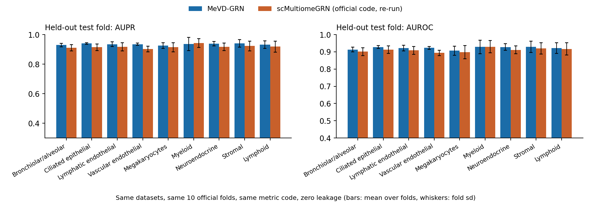
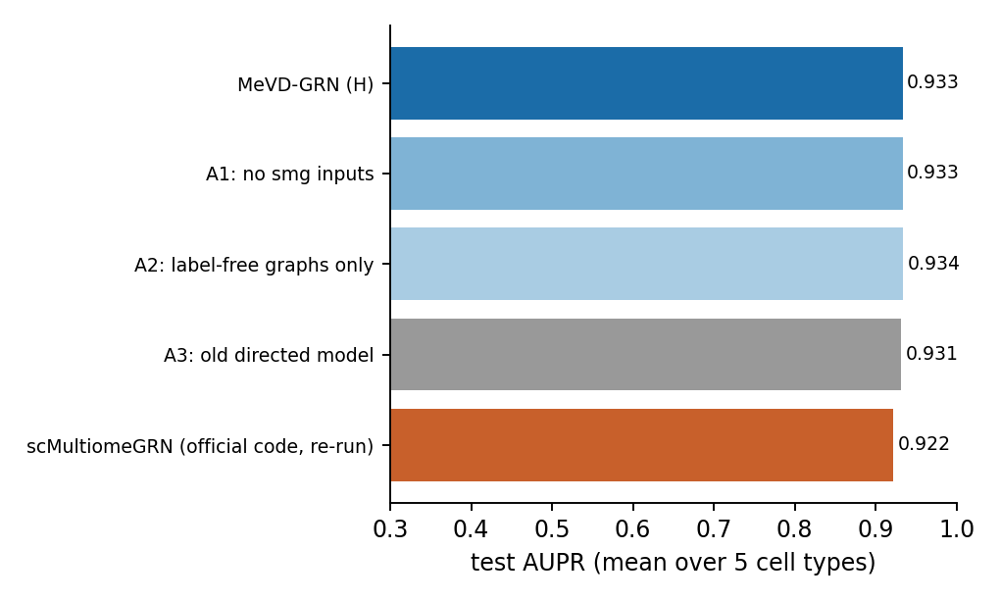

# MeVD-GRN vs scMultiomeGRN on scMultiomeGRN's own benchmark

Advisor meeting, Saturday 17 Oct 2026, 11:00. Period covered: 11 to 17 Oct 2026. Slides are separated by `---`.
Branch `scmgrn-tftf`. Experiment write-up with every deviation: `docs/experiments/scmultiomegrn_generalization.md` (section 11).

> **Reading guide.** Every MeVD-GRN number here is zero-leakage: the held-out fold's links and non-links never enter training,
> and the input graphs are built without labels (checked in code on every fold, recorded in every result file).
> Sections marked **[UPDATE]** are appended as runs finish. A table shows "–" where a run has not finished.

---

## 1. Summary (updated 16 Oct, 20:20; all 9 lung and all 3 hematopoiesis cell types have both methods finished)

1. **We rebuilt scMultiomeGRN's benchmark and reproduced its published numbers.** The regenerated TF-TF answer keys are within
   5% of the paper's link counts on all 9 lung cell types, our fold files are byte-identical to what their split code writes,
   and their own code, re-run on our data, scores what the paper reports (for example Bronchiolar 0.913 / 0.760, Neuroendocrine 0.920 / 0.820,
   Myeloid 0.943 / 0.849, HSC 0.927 / 0.696, on the paper's metric).
2. **We changed MeVD-GRN to predict undirected TF-TF links**, the task scMultiomeGRN solves (it used to predict directed TF-to-gene edges),
   and gave it scMultiomeGRN's own inputs.
3. **On the held-out test fold, MeVD-GRN beats scMultiomeGRN on 8 of the 9 lung cell types, and on all three hematopoiesis cell types.**
   Lung, averaged over the 9 cell types: MeVD-GRN 0.922 / 0.935 vs scMultiomeGRN 0.910 / 0.918 (AUROC / AUPR); pooled paired gain **+0.017 AUPR, +0.012 AUROC**; individually significant on 6 of 9 cell types. Hematopoiesis, pooled over HSC, CMP and GMP: +0.017 AUPR (+0.020 HSC, +0.023 CMP, +0.008 GMP) and +0.009 AUROC.
   The gains are small (1 to 3 points) next to the fold-to-fold spread (2 to 5 points). Myeloid is the one lung cell type where scMultiomeGRN is ahead (not significant).
4. **The ablations say the gain does not come from the scMultiomeGRN-specific inputs or from the training graph.** A variant that never sees
   the training links scores the same as the full model. This fits the main caveat of the benchmark: the answer key is generated from the
   same ATAC data the models read (section 10).
5. **Status:** all main runs are finished (section 12). Component ablations of MeVD-GRN are running (section 8b).

---

## 2. The datasets

**Human fetal lung** (Domcke et al., Science 2020; GEO GSM4508936): 72,662 cells, 9 cell types, sci-ATAC-seq3.
The object's "RNA" assay is gene-body accessibility (per the GEO description), not RNA, so both modalities come from ATAC.

| Cell type | Cells | TF nodes | TF-TF links (undirected) | Directed entries (ours / paper "Initial") | Link density |
|---|---|---|---|---|---|
| Myeloid | 1,288 | 46 | 266 | 532 / 542 | 0.26 |
| Lymphoid | 1,860 | 41 | 301 | 602 / 613 | 0.37 |
| Megakaryocytes | 568 | 64 | 459 | 918 / 930 | 0.23 |
| Neuroendocrine | 544 | 69 | 674 | 1,348 / 1,361 | 0.29 |
| Lymphatic endothelial | 662 | 94 | 936 | 1,872 / 1,889 | 0.21 |
| Stromal | 43,289 | 94 | 1,044 | 2,088 / 2,104 | 0.24 |
| Bronchiolar and alveolar epithelial | 18,988 | 115 | 1,346 | 2,692 / 2,712 | 0.21 |
| Ciliated epithelial | 1,111 | 228 | 4,254 | 8,508 / 8,503 | 0.16 |
| Vascular endothelial | 4,352 | 271 | 5,026 | 10,052 / 9,609 | 0.14 |

**Human adult hematopoiesis** (Buenrostro et al., Cell 2018; scATAC from GEO GSE96769, scRNA from the paper's Data S2; scATAC and scRNA are separate experiments, as in the scMultiomeGRN paper).

| Cell type | scATAC cells | scRNA cells | TF nodes | TF-TF links |
|---|---|---|---|---|
| HSC | 347 | 2,268 | 150 | 1,519 |
| CMP | 502 | 4,454 (cmp0+cmp1+cmp2, our reading) | 171 | 2,016 |
| GMP | 402 | 1,096 | 157 | 1,556 |

**The answer key is not experimental.** scMultiomeGRN (following DeepTFni) defines a link between two TFs when a binding-motif hit of one TF
(HOCOMOCO v11, FIMO p ≤ 1e-6) falls inside the promoter (TSS ± 2 kb) of the other, in peaks open in more than 10% of the cell type's cells.
We regenerated it with the same tools and thresholds. The task is therefore to recover a motif-in-promoter rule among TFs.

---

## 3. The two models

**scMultiomeGRN** (Xu et al., NAR 2025)
- Nodes are TFs. Inputs per TF: its accessibility score (MAESTRO regulatory potential, one value per cell) and its GRNBoost2 importance
  towards every gene; per TF pair, a 16 × 16 joint expression histogram.
- Two graph neural networks (one per modality) with attention over neighbours, a cross-modal attention layer that mixes them, and an
  inner-product decoder that rebuilds the adjacency. Trained on the known links with binary cross-entropy (up to 2,000 epochs, early stopping, lr 1e-5).
- Final network = majority vote over 10 runs. We use the official code unmodified.

**MeVD-GRN, as used here**
- A node-level encoder per source (RNA/accessibility summary features, ATAC gene activity, and a frozen Geneformer gene embedding), two relational
  GraphSAGE networks over label-free gene graphs (co-expression kNN, accessibility-based TF-candidate graph; optionally the training links),
  fused into one embedding per TF.
- **New this week:** an undirected pair decoder. The score of (u, v) is built from h_u*h_v, |h_u - h_v|, h_u + h_v, a diagonal bilinear term,
  an expression-correlation term and optional pair features, so it is identical whichever TF comes first (unit-tested).
- Inputs matched to scMultiomeGRN in the headline variant: its MAESTRO and GRNBoost2 features (compressed to 64 numbers each), its pair histogram,
  and the training links as message-passing edges. 5.07 M parameters (headline variant).
- Trains in about 3 seconds per fold; the official code takes about 1 to 5 minutes per fold depending on the cell type.

| Variant | What it is | Parameters |
|---|---|---|
| **H** (headline) | undirected + training links + scMultiomeGRN inputs | 5.07 M |
| A1 | undirected + training links, without the scMultiomeGRN input features | 4.88 M |
| A2 | undirected, label-free graphs only (never sees the training links) | 3.70 M |
| A3 | the old directed model, scores averaged over both directions | 4.44 M |

---

## 3b. What we changed in MeVD-GRN to make the comparison fair

Two changes to the architecture itself, then input and training switches. Code: `src/models/mevd_grn.py` (`task="undirected"`), `src/models/decoder.py`
(`SymmetricPairDecoder`), `src/benchmarks/scmgrn_features.py`, `scripts/16_scmgrn_build_benchmark.py` (step `smg`), `scripts/17_scmgrn_train_eval.py`.

**1. Architecture changes (so the task matches: undirected TF-TF links)**

| | Before (directed TF → gene) | Now (undirected TF-TF) |
|---|---|---|
| Decoder | role-aware: the target's RNA state is gated by its ATAC accessibility; the score depends on which end is the TF | symmetric: `MLP([h_u*h_v, |h_u-h_v|, h_u+h_v])` + diagonal bilinear term + expression-correlation term + optional pair-feature term; the score is identical whichever TF comes first (unit-tested) |
| Embedding | RNA and ATAC graph-network outputs kept separate until the decoder | RNA and ATAC outputs fused after message passing (`Linear → LayerNorm → GELU`) into one embedding per TF |

**2. Input switches (to give MeVD-GRN the same information scMultiomeGRN has; headline variant H)**

| scMultiomeGRN input | How MeVD-GRN receives it |
|---|---|
| MAESTRO accessibility score per TF (per cell) | reduced to 64 numbers (SVD, features only) and added into the RNA channel through an MLP encoder |
| GRNBoost2 importance of the TF towards every gene | reduced to 64 numbers (SVD, features only), same encoder |
| 16 × 16 joint-expression histogram per TF pair | symmetrised, 136 values, one linear term in the decoder |
| the known (training) graph | the fold's training links as a third relation for the graph networks (the slot the motif graph normally uses) |
| (not an input there) motif relation | switched off, because the answer key is itself a motif scan |

None of these inputs uses a held-out link: the reductions and the histogram depend on expression and accessibility only.

**3. Training-protocol changes**
- One example per unordered TF pair; negatives drawn only from the fold's training negatives.
- A single training stage: no multi-evidence curriculum, hard negatives or replay, because the answer key is a single kind of evidence.
- Best epoch chosen on the validation split's AUPR; up to 2,000 epochs with patience of 100 epochs (matches their budget); learning rate 1e-3, 5 negatives per positive.
- The symmetric score matrix is scored with their own `metric_fn`.

**4. What stayed the same**
- The two relational GraphSAGE encoders (RNA channel, ATAC channel) over label-free gene graphs (co-expression kNN, accessibility-based TF-candidate graph).
- The frozen Geneformer gene embedding, hidden size 384, 2 graph layers (the project's recommended configuration, fixed before any result existed).

**Variants that isolate the changes**

| Variant | Undirected decoder | scMultiomeGRN input features | Training links as graph | Parameters |
|---|---|---|---|---|
| H (headline) | yes | yes | yes | 5.07 M |
| A1 | yes | no | yes | 4.88 M |
| A2 | yes | no | no | 3.70 M |
| A3 | no (old directed model, scores averaged) | no | yes | 4.44 M |

On the held-out fold all four are within about 0.005 of each other (section 8), so the headline gain over scMultiomeGRN is not due to the inputs matched to it, the training graph or the undirected decoder.

---

## 4. What "apples to apples" means here

| | scMultiomeGRN | MeVD-GRN |
|---|---|---|
| Data | Domcke lung (9 cell types), Buenrostro hematopoiesis | the same files |
| Answer key | motif-in-promoter graph | the same graph, regenerated with their method |
| Splits | 10 folds, seed 666: test = one fold of links + equal random non-links; val 18% of links | the same files (byte-identical to the official split code) |
| Task | undirected TF-TF links | undirected TF-TF links |
| Scoring code | their `metric_fn` (AUROC, AUPR, accuracy) | the same function |
| Inputs | MAESTRO, GRNBoost2, histograms, training graph | the same four (headline variant) |
| Repeats | official code, 10 folds each: 6 seeds (Myeloid, Lymphoid, Megakaryocytes, Neuroendocrine, Lymphatic), 2 seeds (the rest) | 5 seeds × 10 folds |

**Headline score = the held-out test fold.** The paper's published numbers use a different evaluation (the full N × N matrix, which includes
the links the model trained on). We report both and label the second.

---

## 5. How we kept it fair

- The held-out fold's links and non-links are never in the training data (asserted on every fold).
- Training non-links come only from the fold's training non-links; the best epoch is chosen on the validation split only.
- Input graphs are built without labels; the motif relation is off because the answer key is a motif scan.
- All MeVD-GRN result files record `zero_leak: true`; the compile step aborts otherwise.
- The official scMultiomeGRN code is re-run unmodified on our regenerated data, so any gap to the paper is visible.
- No hyper-parameter was tuned on test results: variants were fixed before any result existed.

---

## 6. Did we rebuild the benchmark correctly? (fidelity checks)

1. **Link counts:** within 5% of the paper's Table S1 on all 9 lung cell types (table in section 2). Largest gap: Vascular endothelial, +4.6%.
2. **Fold files:** identical to the output of the official split code, 30 of 30 files, for all 12 cell types.
3. **Official code, re-run on our data, on the paper's own metric (full matrix), AUROC / AUPR:**

| Cell type | Paper | Our re-run of the official code |
|---|---|---|
| Myeloid | 0.95 / 0.85 | 0.943 / 0.849 |
| Lymphoid | 0.93 / 0.86 | 0.929 / 0.861 |
| Megakaryocytes | 0.92 / 0.78 | 0.917 / 0.788 |
| Neuroendocrine | 0.92 / 0.82 | 0.920 / 0.820 |
| Lymphatic endothelial | 0.93 / 0.81 | 0.915 / 0.781 |
| Bronchiolar and alveolar | 0.91 / 0.76 | 0.913 / 0.760 |
| Ciliated epithelial | 0.93 / 0.75 | 0.918 / 0.730 |
| Vascular endothelial | 0.90 / 0.67 | 0.899 / 0.668 |
| Stromal | 0.93 / 0.80 | 0.927 / 0.800 |
| HSC (hematopoiesis) | 0.92 / 0.67 | 0.927 / 0.696 |
| CMP (hematopoiesis) | 0.92 / 0.66 | 0.927 / 0.692 |
| GMP (hematopoiesis) | 0.93 / 0.71 | 0.928 / 0.681 |

Averaged over the 9 lung cell types the official re-run scores 0.920 / 0.784 on the paper's metric, against the paper's reported average of 0.924 / 0.790. Per cell type the re-runs match to within about 0.01 AUROC and 0.03 AUPR (closest on Bronchiolar, Myeloid, Lymphoid, Neuroendocrine, Stromal, HSC). The benchmark therefore reproduces the paper; comparisons made on it are meaningful.

---

## 7. Headline result: held-out test fold, lung (all 9 cell types)

AUROC / AUPR, mean over 10 folds then over seeds.

| Cell type | **MeVD-GRN H** | A1 | A2 | A3 | scMultiomeGRN (official code) |
|---|---|---|---|---|---|
| Bronchiolar and alveolar | **0.914 / 0.930** | 0.913 / 0.930 | 0.913 / 0.929 | 0.915 / 0.931 | 0.901 / 0.911 |
| Ciliated epithelial | **0.928 / 0.940** | 0.928 / 0.940 | 0.927 / 0.939 | 0.928 / 0.940 | 0.912 / 0.915 |
| Vascular endothelial | **0.923 / 0.934** | 0.923 / 0.935 | 0.921 / 0.932 | 0.923 / 0.934 | 0.894 / 0.902 |
| Stromal | **0.929 / 0.941** | 0.929 / 0.941 | 0.929 / 0.941 | 0.928 / 0.940 | 0.920 / 0.923 |
| Lymphatic endothelial | **0.922 / 0.937** | 0.921 / 0.935 | 0.920 / 0.934 | 0.919 / 0.933 | 0.908 / 0.917 |
| Megakaryocytes | **0.905 / 0.923** | 0.907 / 0.925 | 0.902 / 0.923 | 0.901 / 0.920 | 0.898 / 0.915 |
| Myeloid | 0.927 / 0.933 | 0.928 / 0.936 | 0.928 / 0.937 | 0.930 / 0.939 | **0.930 / 0.943** |
| Neuroendocrine | **0.927 / 0.938** | 0.928 / 0.939 | 0.929 / 0.940 | 0.928 / 0.939 | 0.912 / 0.917 |
| Lymphoid | **0.926 / 0.935** | 0.922 / 0.932 | 0.927 / 0.937 | 0.921 / 0.926 | 0.917 / 0.918 |
| **Average of the 9** | **0.922 / 0.935** | 0.922 / 0.935 | 0.922 / 0.935 | 0.921 / 0.934 | 0.910 / 0.918 |

Fold-paired comparison, H minus official code (10 folds per cell type, Wilcoxon signed-rank):

| Cell type | AUPR difference | p | AUROC difference | p |
|---|---|---|---|---|
| Vascular endothelial | +0.033 | 0.002 | +0.029 | 0.002 |
| Ciliated epithelial | +0.025 | 0.002 | +0.016 | 0.004 |
| Neuroendocrine | +0.021 | 0.002 | +0.015 | 0.004 |
| Lymphatic endothelial | +0.020 | 0.002 | +0.014 | 0.010 |
| Bronchiolar and alveolar | +0.019 | 0.004 | +0.013 | 0.014 |
| Stromal | +0.019 | 0.004 | +0.009 | 0.020 |
| Lymphoid | +0.017 | 0.105 | +0.009 | 0.375 |
| Megakaryocytes | +0.009 | 0.160 | +0.007 | 0.275 |
| Myeloid | -0.011 | 0.375 | -0.003 | 0.695 |
| **Pooled (90 fold pairs)** | **+0.017** | **5e-11** | **+0.012** | **2e-9** |

In 83% of the 90 cell-type-by-fold pairs MeVD-GRN is ahead on AUPR (78% on AUROC).
How to read this: the gains are small (one to three points of AUPR), the fold-to-fold standard deviation is 2 to 5 points, 6 of 9 cell types are
individually significant (with only 10 folds each, p = 0.002 is the smallest value a paired test can give), and the pooled p-value treats folds
within a cell type as independent although they share a graph, so it is optimistic.

---

## 8. Ablations: what produces the score?

On the held-out fold, the four MeVD-GRN variants are within about 0.005 of each other on every cell type finished (7 lung, 2 hematopoiesis).

- **A2** never sees the training links (only label-free graphs and features) and scores the same as H. The headline gain therefore does not come from
  message passing over known links.
- **A1 ≈ H:** the scMultiomeGRN-specific inputs (MAESTRO, GRNBoost2, pair histograms) add nothing measurable on top of our own features.
- **A3 ≈ H:** the old directed model scores the same, so the undirected decoder is needed for the task definition but is not what produces the gain.

Interpretation: a TF's accessibility and sequence-related features alone already predict whether it has a motif-promoter link,
because the answer key is a function of the same ATAC data (section 9).

---

## 8b. Component ablations of MeVD-GRN (all 12 cell types: 9 lung + 3 hematopoiesis)

Each row changes one component of the headline variant H (same folds, 5 seeds, zero-leak). Held-out test fold, averaged over the 12 cell types;
"diff vs H" is the mean over the 120 cell-type-by-fold pairs, p is a fold-paired Wilcoxon test against H (`scripts/20_scmgrn_ablation_table.py`).

| Variant | test AUPR | diff vs H | p | test AUROC | diff vs H | p |
|---|---|---|---|---|---|---|
| **H**: headline (Geneformer + 384-wide GNN, undirected, training graph, scMultiomeGRN inputs) | 0.9349 | – | – | 0.9237 | – | – |
| only the scMultiomeGRN node features (no pair histograms) | 0.9347 | -0.0002 | 0.99 | 0.9237 | -0.0001 | 0.92 |
| only the pair histograms (no scMultiomeGRN node features) | 0.9347 | -0.0002 | 0.39 | 0.9237 | -0.0001 | 0.61 |
| A1: no scMultiomeGRN inputs | 0.9350 | +0.0001 | 0.33 | 0.9236 | -0.0001 | 0.94 |
| A2: A1 and no training graph | 0.9345 | -0.0004 | 0.19 | 0.9228 | -0.0009 | 0.002 |
| A3: old directed model, scores averaged | 0.9341 | -0.0008 | 0.43 | 0.9226 | -0.0011 | 0.07 |
| no Geneformer gene embedding | 0.9343 | -0.0006 | 0.30 | 0.9229 | -0.0008 | 0.03 |
| no ATAC channel | 0.9345 | -0.0003 | 0.40 | 0.9235 | -0.0002 | 0.27 |
| no graph network (features straight to the decoder) | 0.9340 | -0.0009 | 0.005 | 0.9226 | -0.0011 | 0.02 |
| co-expression graph only (also drops the training links) | 0.9340 | -0.0009 | 0.07 | 0.9223 | -0.0014 | 0.0009 |
| TF-candidate graph only (also drops the training links) | 0.9339 | -0.0009 | 0.04 | 0.9225 | -0.0012 | 0.01 |
| base size (128-wide, no Geneformer; 0.53 M parameters instead of 5 M) | 0.9348 | -0.0000 | 0.71 | 0.9237 | -0.0001 | 0.92 |
| *reference:* scMultiomeGRN, official code | 0.9180 | **-0.0169** | 2e-15 | 0.9124 | **-0.0114** | 7e-13 |

**What this shows**
- Removing any single component changes the held-out score by 0.001 or less, in both metrics. A few of these differences are statistically detectable
  (for example no graph network, p = 0.005), but they are about one fifth of the gap to scMultiomeGRN and of no practical size.
- The gap to scMultiomeGRN (-0.017 AUPR) is an order of magnitude larger than any ablation effect, so it is robust to everything we varied.
- Even the 0.53 M-parameter base model without Geneformer matches H. Model size, the pretrained embedding, the ATAC channel, the graph networks, the training
  links and the scMultiomeGRN inputs are all dispensable on this benchmark.
- So whatever produces the score is shared by every variant: the per-TF summary features, the co-expression term and the symmetric pair decoder, trained with the same objective.
  A "floor" run (all optional components removed at once) quantifies how little is needed: see the next paragraph.

**Floor run (everything optional removed at once):** 128-wide, no Geneformer, no ATAC channel, no graph network, no training graph, no scMultiomeGRN inputs; 0.10 M parameters. [UPDATE: results appended below when finished.]

Caveats: the p-values pool 120 cell-type-by-fold pairs that are not independent (folds share a graph); and on lung both channels are accessibility-derived, so removing the ATAC channel removes little information.

---

## 9. Same benchmark, the paper's own protocol (full matrix; contains training links)

AUROC / AUPR. **This set includes the links the model was trained on, so it is not a leakage-free measure.** Shown to compare with the published numbers.

| Cell type | MeVD-GRN H | A3 | scMultiomeGRN (official code) | Paper (published) |
|---|---|---|---|---|
| Bronchiolar and alveolar | 0.940 / 0.849 | 0.938 / 0.855 | 0.913 / 0.760 | 0.91 / 0.76 |
| Ciliated epithelial | 0.938 / 0.828 | 0.939 / 0.833 | 0.918 / 0.730 | 0.93 / 0.75 |
| Vascular endothelial | 0.935 / 0.800 | 0.935 / 0.802 | 0.899 / 0.668 | 0.90 / 0.67 |
| Stromal | 0.952 / 0.886 | 0.953 / 0.890 | 0.927 / 0.800 | 0.93 / 0.80 |
| Lymphatic endothelial | 0.939 / 0.850 | 0.942 / 0.862 | 0.915 / 0.781 | 0.93 / 0.81 |
| Megakaryocytes | 0.938 / 0.846 | 0.937 / 0.855 | 0.917 / 0.788 | 0.92 / 0.78 |
| Myeloid | 0.956 / 0.877 | 0.958 / 0.892 | 0.943 / 0.849 | 0.95 / 0.85 |
| Neuroendocrine | 0.951 / 0.893 | 0.952 / 0.900 | 0.920 / 0.820 | 0.92 / 0.82 |
| Lymphoid | 0.951 / 0.902 | 0.950 / 0.898 | 0.929 / 0.861 | 0.93 / 0.86 |
| **Average of the 9** | 0.945 / 0.859 | 0.945 / 0.865 | 0.920 / 0.784 | 0.924 / 0.79 |

The pooled difference on this set is +0.075 AUPR (90 pairs). It is larger than on the held-out fold because a higher-capacity model fits the training links better;
it should not be read as better generalisation.

---

## 9b. Hematopoiesis (Buenrostro 2018): HSC, CMP, GMP (all finished)

Held-out test fold, AUROC / AUPR:

| Cell type | **MeVD-GRN H** | A1 | A2 | A3 | scMultiomeGRN (official code) |
|---|---|---|---|---|---|
| HSC | **0.934 / 0.940** | 0.934 / 0.941 | 0.931 / 0.937 | 0.932 / 0.940 | 0.922 / 0.921 |
| CMP | **0.925 / 0.932** | 0.925 / 0.932 | 0.924 / 0.931 | 0.924 / 0.932 | 0.914 / 0.909 |
| GMP | **0.925 / 0.934** | 0.925 / 0.935 | 0.922 / 0.934 | 0.924 / 0.935 | 0.921 / 0.926 |
| average | **0.928 / 0.936** | 0.928 / 0.936 | 0.926 / 0.934 | 0.927 / 0.936 | 0.919 / 0.919 |

Fold-paired, H minus official: HSC +0.020 AUPR (p = 0.002), +0.012 AUROC (p = 0.002); CMP +0.023 AUPR (p = 0.002), +0.012 AUROC (p = 0.002);
GMP +0.008 AUPR (p = 0.049), +0.004 AUROC (p = 0.23). Pooled (30 pairs): +0.017 AUPR (p = 6e-8), +0.009 AUROC (p = 8e-7); ahead in 90% of the fold pairs.

Paper protocol (full matrix, contains training links), AUROC / AUPR:

| Cell type | MeVD-GRN H | scMultiomeGRN (official code re-run) | Paper (published) |
|---|---|---|---|
| HSC | 0.945 / 0.790 | 0.927 / 0.696 | 0.92 / 0.67 |
| CMP | 0.945 / 0.800 | 0.927 / 0.692 | 0.92 / 0.66 |
| GMP | 0.943 / 0.784 | 0.928 / 0.681 | 0.93 / 0.71 |

The same pattern as lung: a small held-out-fold gain, and the four MeVD-GRN variants indistinguishable from each other.
Caveats specific to hematopoiesis: scATAC and scRNA come from separate experiments (as in the paper), the scATAC counts come from the GEO matrix (GSE96769)
rather than from per-cell BAM files, and the CMP scRNA cells (cmp0, cmp1, cmp2) are our reading of the paper.

---

## 10. Honest caveats

- **The answer key is built from the same ATAC data the models read** (motif hit in an open promoter). A model can score well by learning that
  rule, without learning regulation. The same holds for scMultiomeGRN; the ablations suggest it holds for us too. This benchmark cannot tell
  "learns regulation" from "learns the construction rule".
- **Lung "RNA" is gene-body accessibility**, not expression, so both modalities come from ATAC.
- **Small graphs:** the lung cell types have 41 to 271 TFs and 266 to 5,026 links; each held-out fold has only 27 to 503 positive links (hematopoiesis: 150 to 171 TFs, 1,500 to 2,000 links).
- **Official code seeds:** 6 seeds for the first five cell types, 2 (666 and 42) for the rest, because the code is near-deterministic across seeds
  (Myeloid, 6 seeds: all within 0.001) and costs about 5 minutes per fold on the large cell types.
- **Deviation from the official preprocessing:** the Seurat object stores no variable-gene list, so GRNBoost2 uses genes detected in more than 10% of
  cells (plus all TFs), following the paper's own filter. Applies to both methods.
- **CMP scRNA** is our reading of three labels (cmp0, cmp1, cmp2); the paper does not say which it used.
- **Not tested here:** whether the result transfers to experimentally derived answer keys (that is what BEAR-GRN offers).

---

## 12. Progress of the runs (updated 16 Oct, 20:20)

| Dataset / cell type | Status | MeVD-GRN (4 variants × 5 seeds × 10 folds) | Official code |
|---|---|---|---|
| Lung: Myeloid, Lymphoid, Megakaryocytes, Neuroendocrine, Lymphatic | **finished** | done | 6 seeds done |
| Lung: Bronchiolar, Ciliated, Vascular endothelial | **finished** | done | 2 seeds done |
| Component ablations of MeVD-GRN (8 variants × 5 seeds, all 12 cell types) | running (see 8b) | in progress | – |
| Lung: Stromal (43k cells) | **finished** (official code: 17 min per fold) | done | 2 seeds done |
| Hematopoiesis: HSC, CMP, GMP | **finished** | done | 2 seeds done |

*(Further updates are appended below as results arrive.)*

---

## 13. Engineering notes (for the record)

Problems met and fixed while running on real data, all in `docs/experiments/scmultiomegrn_generalization.md` section 11.8:
- Ada's outbound internet is about 10 to 140 KB/s per connection; the 3 GB lung file was streamed from the laptop over the VPN (about 3.5 hours).
- The GEO lung file is gzipped twice; the Seurat object has no variable-gene list.
- Official code ran out of memory on the large cell types when workers were given 6 GB; fixed with 30 GB per worker.
- A bug in the worker queue (ssh swallowing its own input list) made the laptop worker stop early; fixed and re-tested.

---

## Appendix. Where things are

- Code: branch `scmgrn-tftf` (model: `src/models/mevd_grn.py`, `src/models/decoder.py`; features: `src/benchmarks/scmgrn_features.py`;
  scripts 14b/16/17/18/19; jobs `slurm/scmgrn_*.sh`; tests `tests/`).
- Results on Ada: `~/scmgrn/results/{lung,hema}/<cell type>/<method>/seed*/fold*.json`; compiled with `scripts/19_scmgrn_compile.py`.
- Figures: `docs/presentation/make_scmgrn_figs.py` (to `docs/presentation/figs_scmgrn/`).
